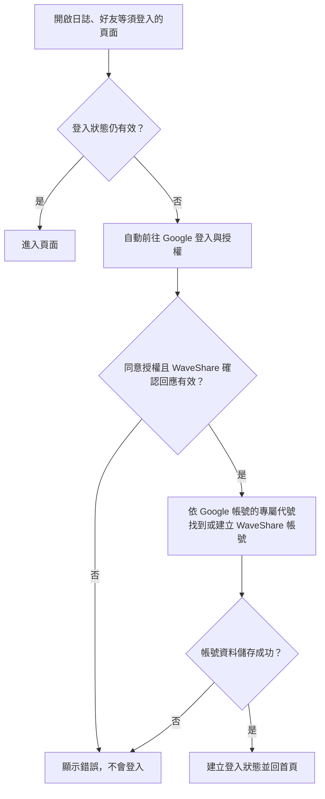
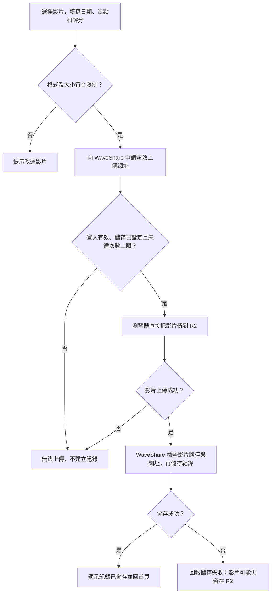
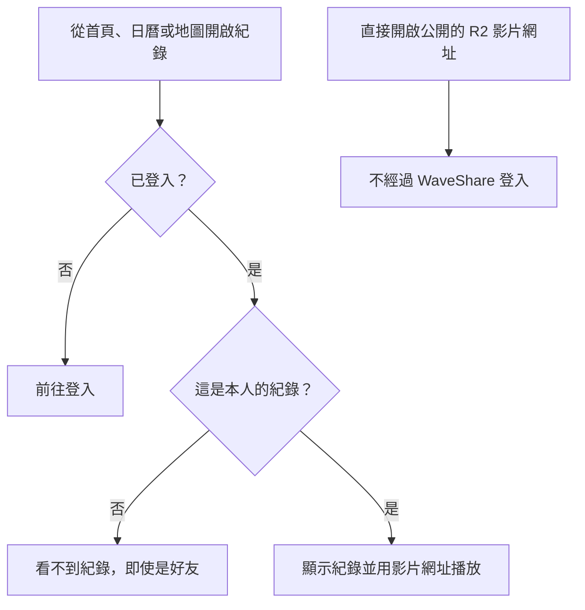
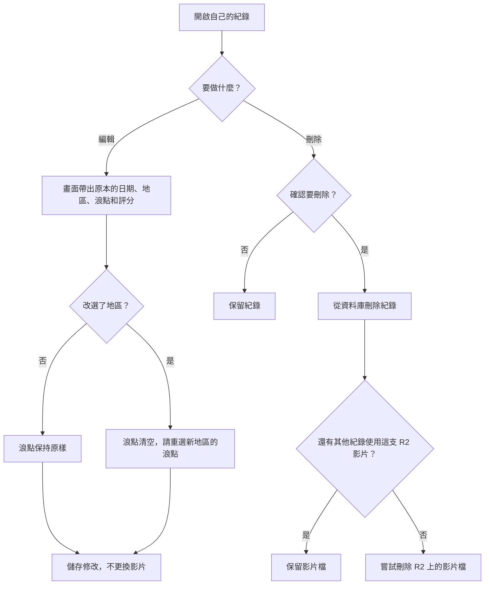
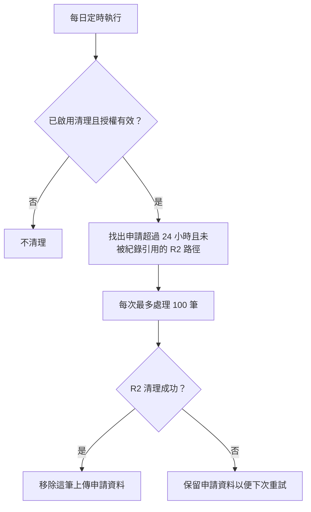

# WaveShare 流程圖

流程以編寫時的主分支為準，不代表正式網站已部署或驗證。[回文件首頁](README.md)

## 1. 使用 Google 帳號登入

以下假設已依[部署教學](DEPLOY.zh-TW.md)設定 Google 登入與 TiDB Cloud。

即使電子郵件相同，第一次用 Google 登入也會建立新帳號，不會自動合併舊 Manus 帳號。

## 2. 新增紀錄：直接傳到 R2

上傳網址有效 10 分鐘。每位使用者在任意連續 24 小時內最多申請 10 次，沒傳完也算。影片不經過 WaveShare 後端，所以不受 Vercel 約 4.5 MB 的請求限制；PR #1 之前經由後端轉存到 Manus Forge 的做法已移除。

## 3. 回看紀錄與播放影片

R2 影片可憑公開網址播放。PR #1 之前上傳的 Forge 影片仍使用原網址，可否直接播放取決於原儲存服務。

## 4. 編輯或刪除紀錄

編輯時只改評分或心得，原本的浪點不會被清空（[PR #4](https://github.com/ChristingChang/waveshare/pull/4) 修正）。R2 刪檔失敗不會復原日誌；舊 Forge 影片不受影響。

## 5. 未使用影片的清理（選用）

清理適用於上傳後沒存成紀錄的 R2 影片；不會清理仍被引用的影片或舊 Forge 影片。設定及上線前檢核見[架構決策紀錄](architecture-decisions.md)。
