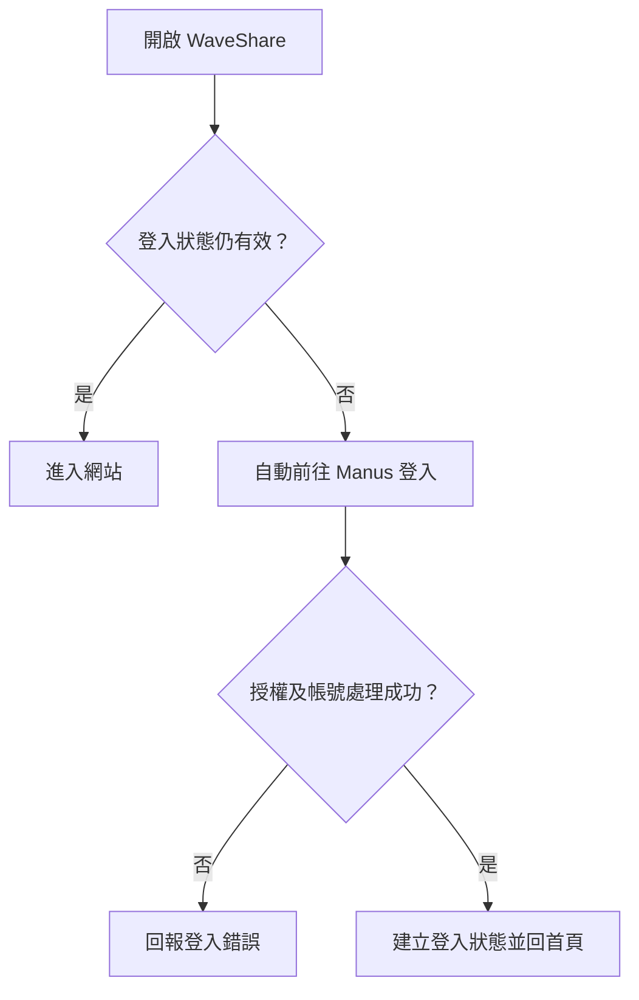
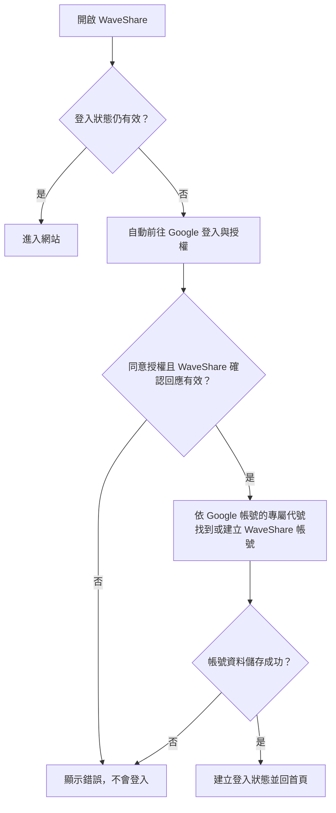
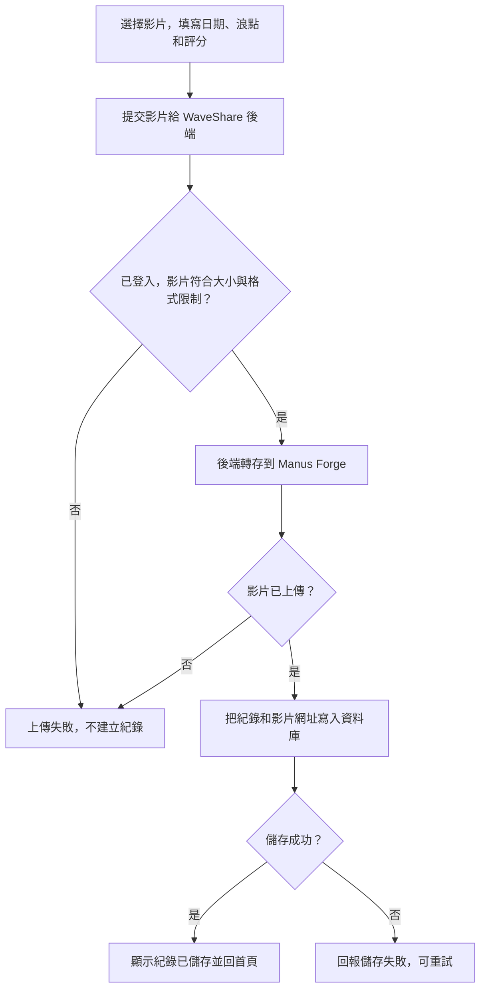
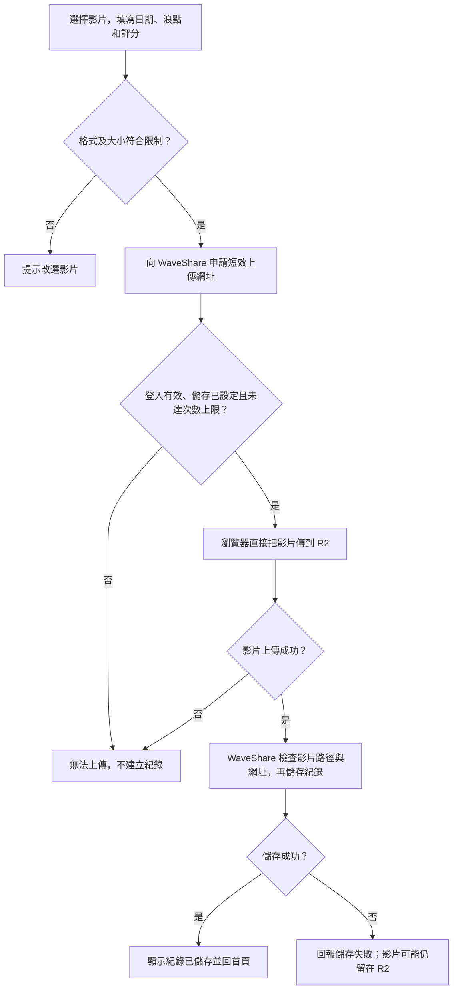
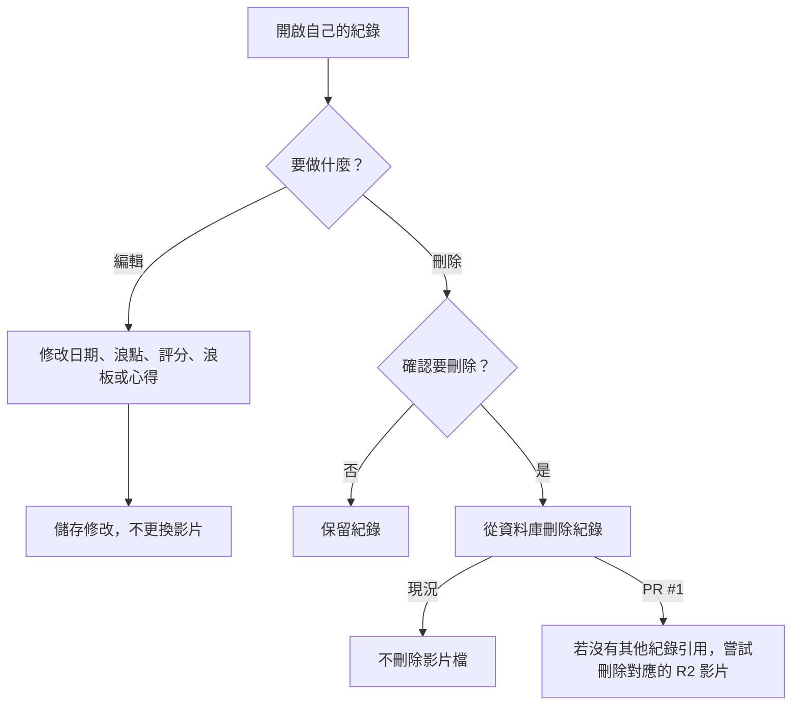
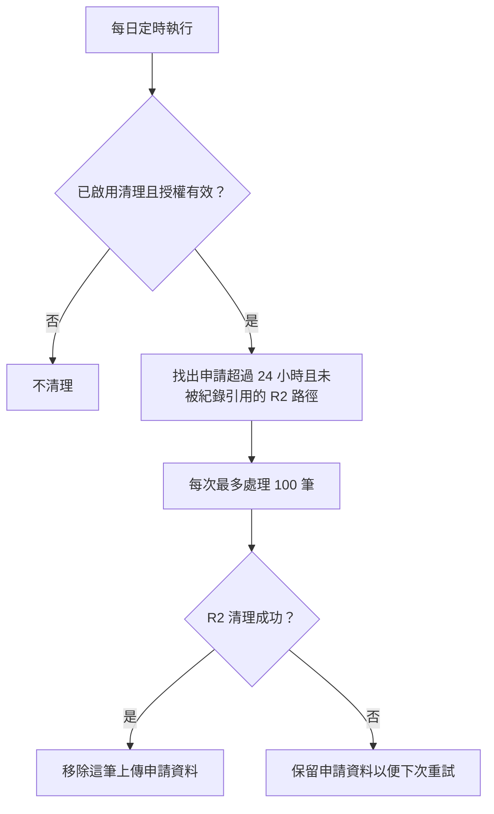

# WaveShare 流程圖

「現況」指編寫時的主分支；標有 [PR #1](https://github.com/ChristingChang/waveshare/pull/1) 或 [PR #2](https://github.com/ChristingChang/waveshare/pull/2) 的流程尚未合併，並非正式站已上線的功能。[回文件首頁](README.md)

## 1. 登入：現況（Manus）

## 2. 登入：PR #2（Google／TiDB Cloud）

以下假設 Google 登入與 TiDB Cloud 資料庫已正確設定。

即使電子郵件相同，第一次用 Google 登入也會建立新帳號，不會自動合併舊 Manus 帳號。

## 3. 新增紀錄：現況（後端轉存）

在 Vercel，過大的請求會在抵達 WaveShare 後端前就被擋下。

## 4. 新增紀錄：PR #1（直接傳到 R2）

上傳網址有效 10 分鐘。每位使用者在任意連續 24 小時內最多申請 10 次，沒傳完也算。

## 5. 回看紀錄與播放影片

PR #1 的 R2 影片可憑公開網址播放。舊 Forge 影片仍使用原網址，可否直接播放取決於原儲存服務。

## 6. 編輯或刪除紀錄

PR #1 的 R2 刪檔失敗不會復原日誌；舊 Forge 影片不受影響。

## 7. 未使用影片的清理：PR #1（選用）

清理適用於上傳後沒存成紀錄的 R2 影片；不會清理仍被引用的影片或舊 Forge 影片。設定及上線前檢核見[架構決策紀錄](architecture-decisions.md)。
