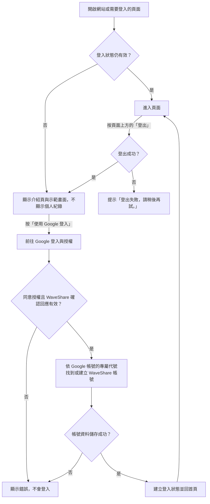
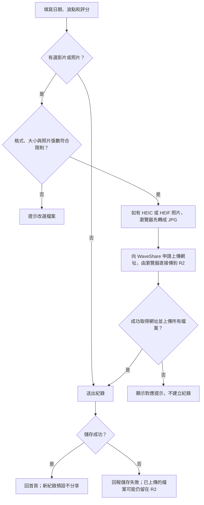
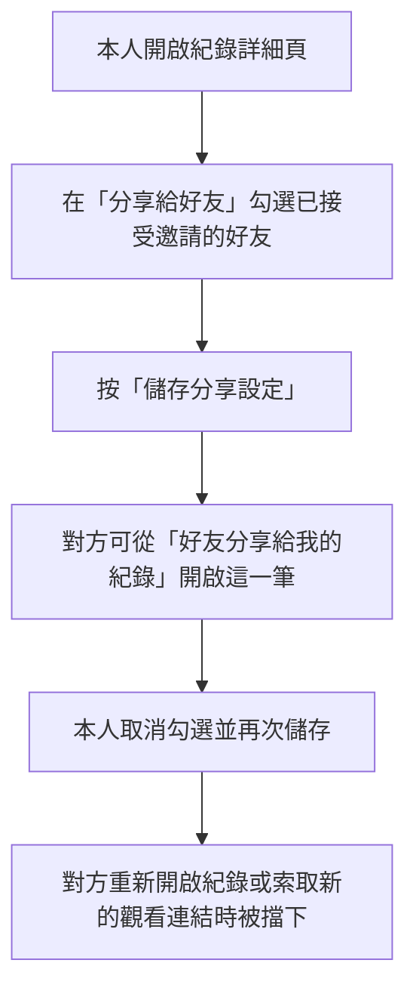
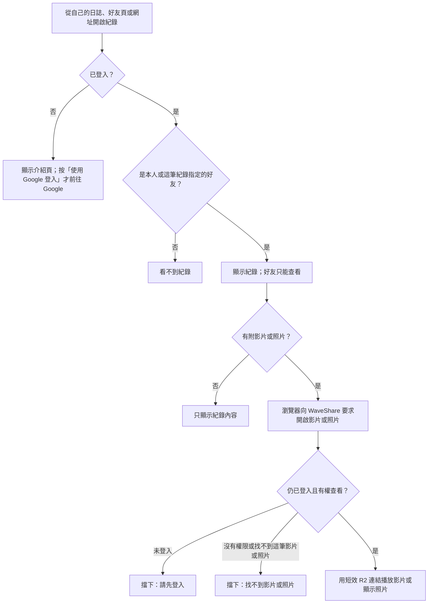
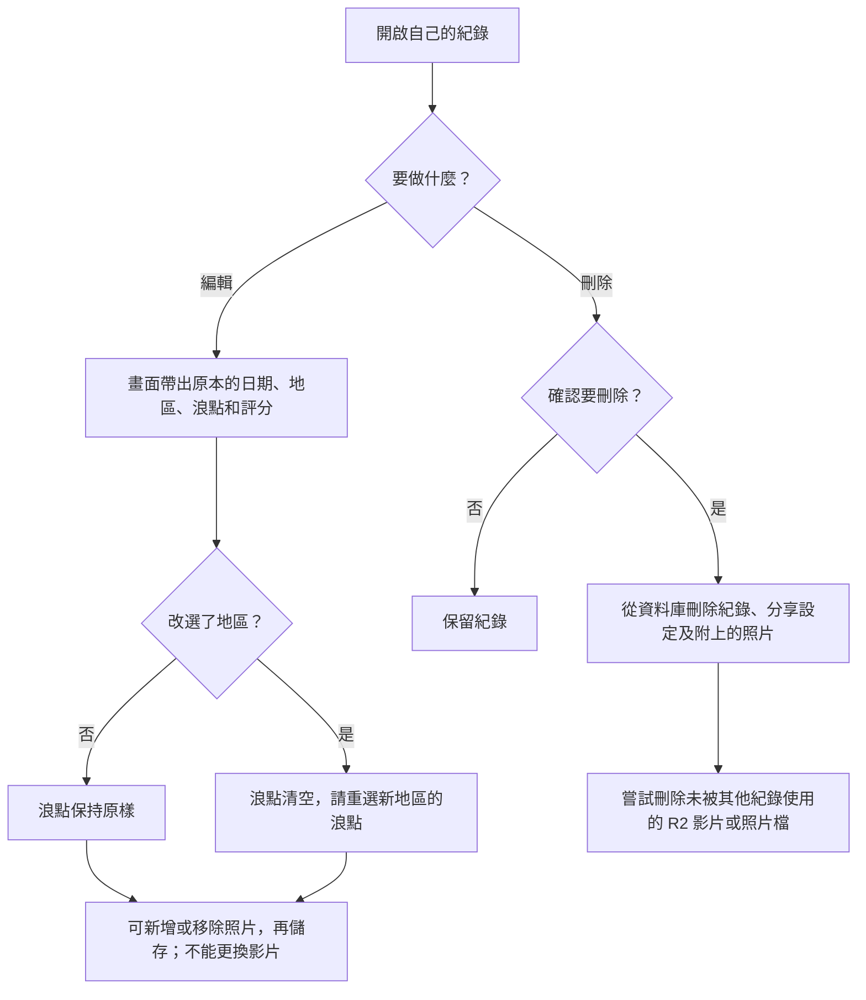
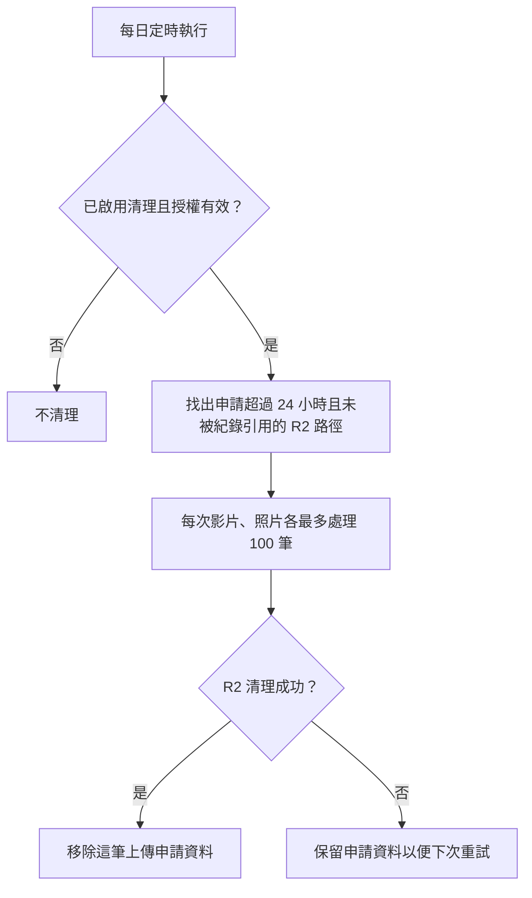
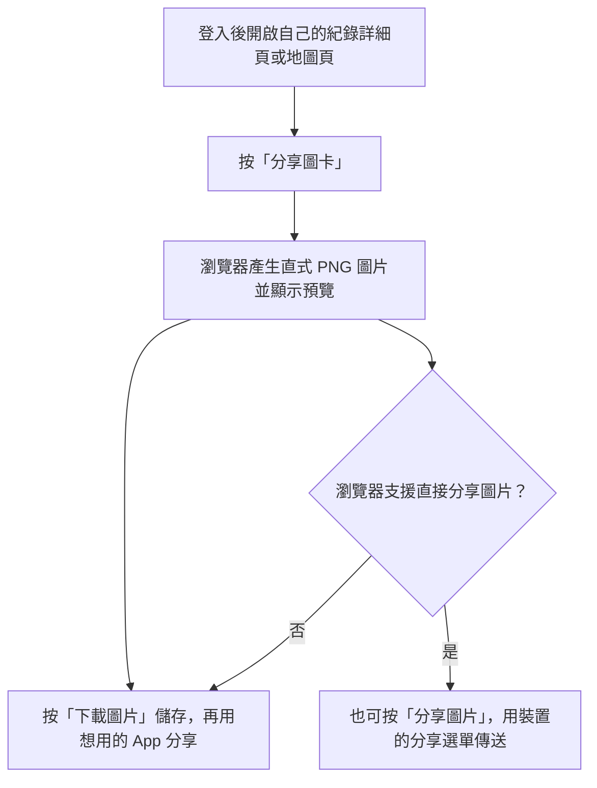

# WaveShare 流程圖

流程以編寫時的主分支為準，不代表正式網站已部署或驗證。[回文件首頁](README.md)

## 1. 瀏覽介紹頁、登入與登出

以下假設已依[部署教學](DEPLOY.zh-TW.md)設定 Google 登入與 TiDB Cloud。

即使電子郵件相同，第一次用 Google 登入也會建立新帳號，不會自動合併舊 Manus 帳號。

## 2. 新增紀錄：影片與照片都可不填

上傳網址有效 10 分鐘。每位使用者在任意連續 24 小時內最多申請 10 次影片上傳及 100 次照片上傳，沒傳完也算。檔案不經過 WaveShare 後端，所以不受 Vercel 約 4.5 MB 的請求限制。

新增或編輯時，照片傳不上去會顯示對應的提示。若提示缺少照片資料表，請由管理員依[部署教學](DEPLOY.zh-TW.md)啟用照片功能。

## 3. 分享紀錄給指定好友

只分享勾選的這一筆，不會分享其他日誌或個人統計。先前已取得的 R2 觀看連結不會提早失效，有效期為 15 分鐘。

## 4. 回看紀錄、影片與照片

直接打開影片網址 `/api/videos/<紀錄編號>` 或照片網址 `/api/photos/<照片編號>`，也要經過同一項檢查。R2 觀看連結有效 15 分鐘；播放出錯時，播放器會重新取得連結一次，並回到原來的位置。R2 必須關閉公開存取，舊的公開影片網址才會失效。舊 Forge 影片通過檢查後會開啟原網址；原網址本身是否公開，未確認。

## 5. 編輯或刪除紀錄

編輯時只改評分或心得，原本的浪點不會被清空（[PR #4](https://github.com/ChristingChang/waveshare/pull/4) 修正）。R2 刪檔失敗不會復原日誌；舊 Forge 影片不受影響。

## 6. 未使用影片與照片的清理（選用）

清理適用於上傳後沒存成紀錄的 R2 影片和照片；不會清理仍被紀錄使用的檔案或舊 Forge 影片。設定見 [R2 教學](R2_SETUP.zh-TW.md)。

## 7. 預覽、下載或分享圖卡

好友分享給你的紀錄沒有「分享圖卡」按鈕。圖卡不含原始紀錄網址，也不會變更好友分享設定。
